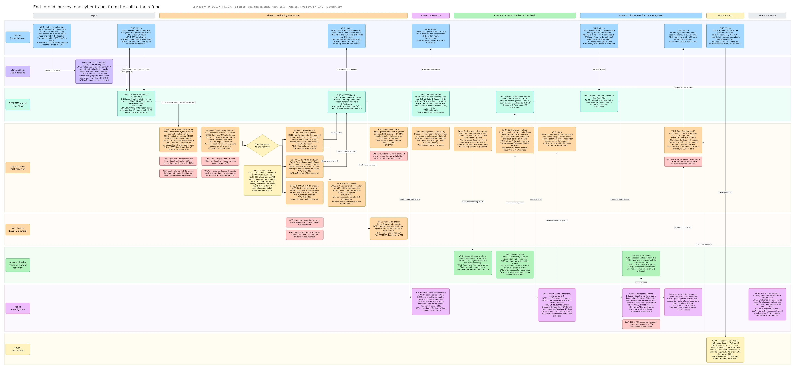
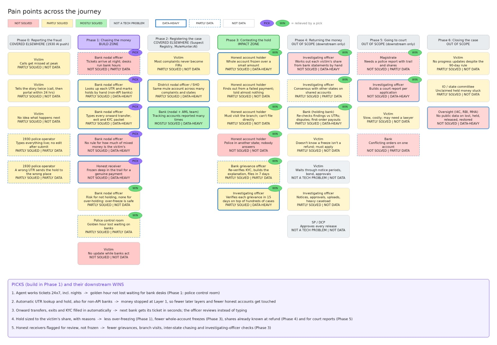
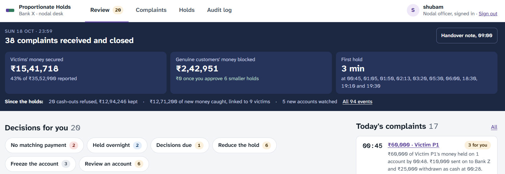
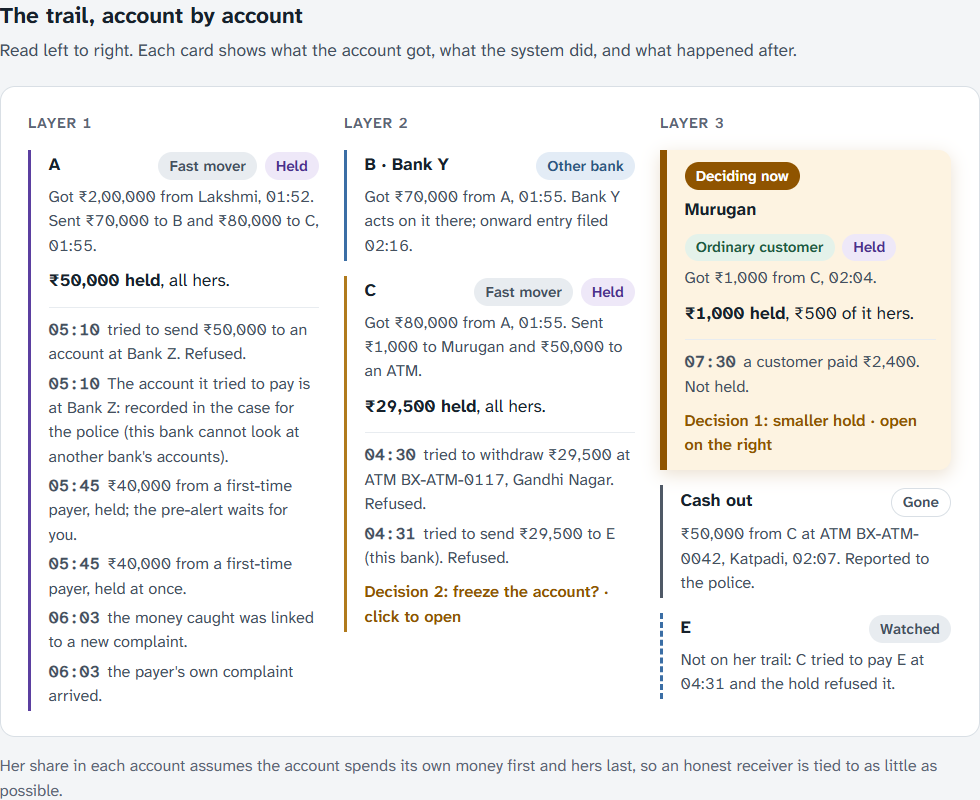
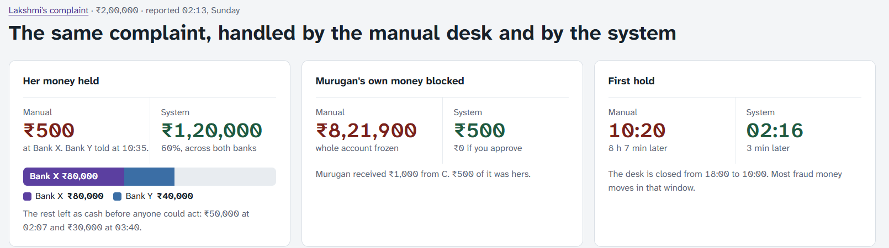
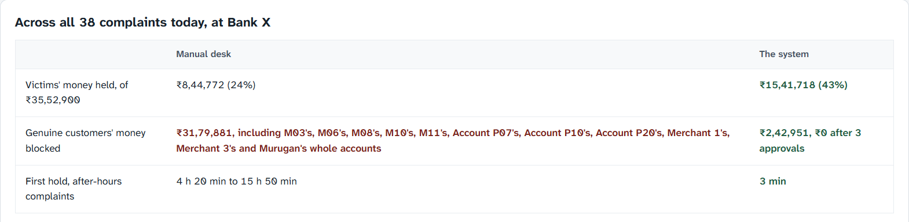
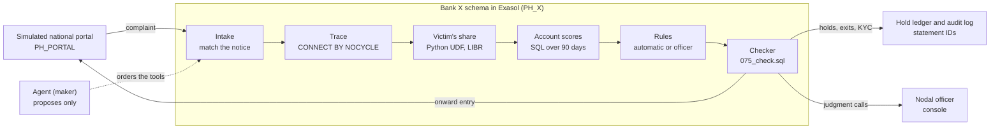
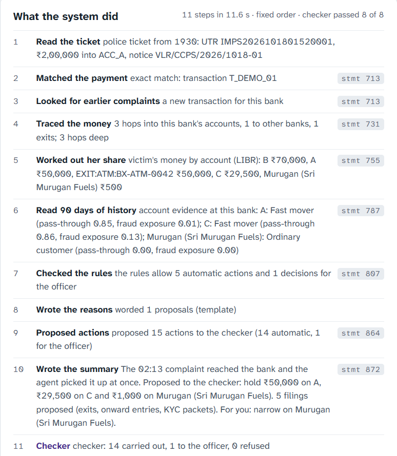
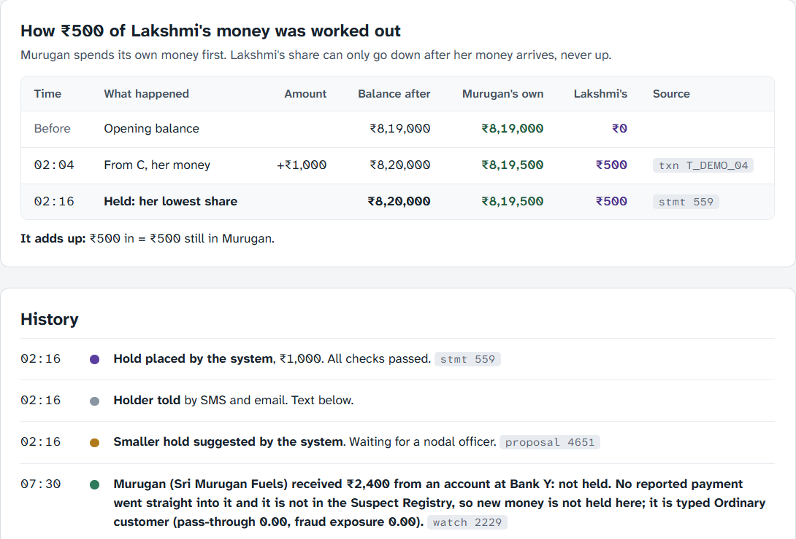
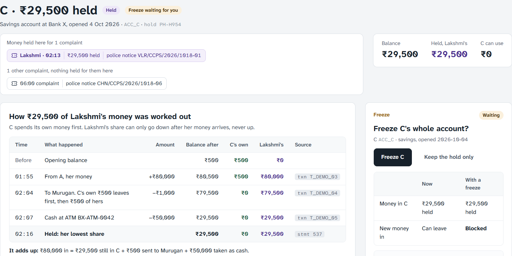

# Proportionate Holds

A bank-side agent that works every cyber-fraud complaint the moment it lands, at any hour. It checks the police
ticket against the bank's transactions, follows the victim's money through the bank, works out how much of each
account is really the victim's, places the holds the rules already require (amount only), files the onward entries,
cash exits and KYC packets, and keeps watching the accounts it touched. The bank nodal officer decides only the
judgment calls, each written up with its reasons and the case against.

Built by **Team Data Dynamos** for **ExaThon India 2026** (Track 01: Money, Risk & Regulation). Every number is
computed in **Exasol Personal** and every number on screen traces to the Exasol statement that produced it.

**Demo video:** [Watch on Google Drive](https://drive.google.com/file/d/1B0AotBv9ShRvmwmEPaquk9ePxzQUFhd1/view?usp=drivesdk)

**Pitch deck:** [docs/Proportionate_Holds_pitch_deck.pdf](docs/Proportionate_Holds_pitch_deck.pdf)
## Problem statement


> A bank nodal officer can't act on a cyber-fraud complaint within the golden hour, while the money is still in the
> first account, because night-time complaints wait for the desk to open and every hop is then traced and held by
> hand. If this worked, the victim's money would be held before it is withdrawn, and only the victim's share of it,
> so honest customers further down the trail keep their accounts.

Why it matters, with sources: [docs/PROBLEM_STATEMENT.md](docs/PROBLEM_STATEMENT.md). How we got there:
[docs/PROBLEM_DISCOVERY.md](docs/PROBLEM_DISCOVERY.md) (the journey, 36 pain points, why Phase 1). What we built:
[docs/DESIGN.md](docs/DESIGN.md).

## The journey and its pain points

We walked one complaint from the victim's call to the refund before designing anything: nine parties, seven phases,
about 30 steps, each with who acts, what they are trying to do, how long it takes and through which channel. The money
is decided in the first columns, at the first bank, where one ticket passes through the portal desk, the core banking
team and the branch, largely by hand.



_Open the image full size to read every step. The same content, as text with sources, is in
[docs/PROBLEM_DISCOVERY.md](docs/PROBLEM_DISCOVERY.md)._

Across the journey we found 36 pain points and tagged each by how solved it already is and how data-heavy it is. We
build for the five in Phase 1 (purple PICK); building them relieves twelve more downstream (green WIN), mostly where
frozen account holders contest their holds.



## What it does

We mapped one complaint end to end (nine parties, seven phases, 36 pain points) and built for the five that sit with
the nodal officer at the first bank, inside the golden hour:

| # | Pain today | What the system does |
| --- | --- | --- |
| 1 | Complaints arrive at night; desks keep bank hours | Works each complaint as it lands, at any hour |
| 2 | Each UTR is looked up and held by hand | Matches the notice to the exact payment and places the mandatory hold, amount only |
| 3 | Every onward transfer, exit and KYC packet is typed by hand | Files them in the same run; the next bank gets its ticket a minute later |
| 4 | No rule for how much of mixed money is the victim's, so desks over-freeze | Works out the victim's share per account (lowest intermediate balance, to the paisa), with written reasons |
| 5 | Honest receivers deep in the trail are frozen | Holds the amount only, and proposes reducing it to the victim's share; never freezes a whole account itself |

**Automatic, at any hour:** mandatory holds (amount only), ATM, cash and crypto exits, onward entries, KYC packets,
sending back a ticket that matches no payment, splitting held money between victims, and watching the accounts it
touched (refused withdrawals and new money).

**The officer decides five things:** reduce a hold to the victim's share, a whole-account freeze, a larger hold when
fraud money leaves an account fast, what to do with a notice that does not match a payment, and release after 75 days
with no police direction.

**Maker, checker, officer.** The agent (the maker) has no tool that changes data: it writes proposals. A deterministic
checker, with its own database user, validates each one against the rules and the checks (conservation to the paisa,
holds within balance, trail and report) and only then holds, files or routes it. Each bank has its own schema and
users and cannot read another bank's data; the simulated national portal is the only link between them
([DESIGN.md](docs/DESIGN.md)).



## The 2:13 a.m. complaint

Lakshmi pays a fake officer ₹2,00,000 at 01:52. Within minutes it is split: ₹70,000 to B at Bank Y, ₹80,000 to C at
Bank X, ₹50,000 out of C at an ATM, and ₹1,000 from C to Sri Murugan Fuels for diesel. The ticket reaches Bank X at
02:13. By 02:16 the system has traced the whole trail and placed the holds:



The **Manual vs system** screen replays the same transactions both ways:



| Lakshmi's complaint | Manual desk | The system |
| --- | --- | --- |
| Her money held | ₹500 at Bank X; Bank Y told at 10:35 | ₹1,20,000 (60%) across both banks: ₹80,000 at Bank X, ₹40,000 at Bank Y |
| Murugan's own money blocked | ₹8,21,900 (his whole account frozen at 10:50) | ₹500, and ₹0 once the officer approves the smaller hold |
| First hold | 10:20, 8 h 7 min after the complaint | 02:16, 3 min after |

The rest left as cash before anyone could act: ₹50,000 at 02:07 and ₹30,000 at Bank Z at 03:40.

The night goes on. At 03:20 a complaint arrives with a UTR one digit off: nothing is held, it goes back to the police
at once, and the near match waits for the officer. At 04:30 C tries an ATM; the hold refuses it and the system proposes
a full freeze. At 05:10 A tries to send ₹50,000 to Bank Z; refused. At 05:45 a second victim's money lands on A and is
held at once; at 06:00 that victim's complaint arrives and the held money is linked to them. At 07:30 a customer pays
Murugan for diesel: not held, and the log says why.

Across **all 38 complaints of the demo day at Bank X** (same screen):

| | Manual desk | The system |
| --- | --- | --- |
| Victims' money held, of ₹35,52,900 reported | ₹8,44,772 (24%) | ₹15,41,718 (43%) |
| Genuine customers' money blocked: money held beyond what is traced to each complaint's victims, summed over the complaints | ₹31,79,881, including whole accounts frozen | ₹2,42,951 |
| First hold, complaints that arrive after hours | 4 h 20 min to 15 h 50 min | 3 min |



The manual desk is a stated model, not a measurement: open 10:00 to 18:00, about 20 minutes for the first account and
15 for each next, whole-account freezes. The **Holds** tab counts a narrower figure, genuine customers' own money in
the holds that have a smaller hold waiting, so the two screens show different amounts.

**At scale** ([docs/BENCHMARK.md](docs/BENCHMARK.md), measured on a laptop): 1,000 complaints arriving at once against
4,487,133 AMLworld transactions were all worked within the hour; one complaint's own work took a median of 5.76 s from
intake to holds, with 0 checker failures and 0 errors.

## How it works



**What runs inside Exasol**

- **Trace:** a set-based join writes the time-ordered links between payments (`TRACE_LINK`), then `CONNECT BY NOCYCLE`
  walks them, bounded by hop count and safe against loops ([D-21](docs/DECISIONS.md)).
- **Victim's share:** a Python UDF replays each account's balance in integer paise under lowest intermediate balance,
  pro rata between victims (`sql/udf/attribute_case.py`). A separate pure-Python oracle in `tests/oracle.py` checks it.
- **Account scores:** two scores, pass-through and fraud exposure, from SQL signals over 90 days of history, with
  credits matched to the debits that follow them by a second UDF (`sql/udf/match_credits.py`). They give one of four
  account types (Pipe for fraud, Fast mover, Exposed business, Ordinary customer) or the grey zone, where nothing is
  suggested ([D-57](docs/DECISIONS.md)).
- **Checker:** `sql/steps/075_check.sql` runs the checks, including conservation to the paisa; the statements that
  change anything refuse to run if a check failed.
- **Scale:** about 5 million AMLworld transactions sit in the same tables as background traffic.
- **Separation:** one schema per bank (`PH_X`, `PH_Y`, `PH_Z`) with its own maker and checker users, plus the portal
  schema (`PH_PORTAL`) as the only link between them.
- **Audit:** every step, hold and decision records the Exasol statement ID behind it, in an insert-only log.

On the 02:13 complaint the agent took 11 steps in 11.6 seconds, in a fixed order, each with the statement behind it,
and the checker passed 8 of 8 checks before anything was held:



## Where AI and ML fit, and where they don't

- **An optional local model** (Ollama, free and offline, so account data never leaves the bank) picks the next tool
  from the ones the rules allow and words the reduce and freeze reasons and the morning log. It never calculates an
  amount and never decides: every sentence must cite the reasons it uses and repeat no number it was not given, or the
  fixed template is used. With the model off, a fixed pipeline places the same holds.
- **Live scoring uses explainable, hand-set weights**, so every hold can be defended signal by signal, which is what
  courts ask for when they review a freeze.
- **Learned models, gated.** Gradient-boosted trees trained on AMLworld's labels rank held-out accounts at an AUC of
  0.870, against 0.537 for the hand-set weights on the same accounts; they are kept as a benchmark, not used in live
  scoring ([docs/LEARNED_SIGNAL.md](docs/LEARNED_SIGNAL.md)). `make learn` retrains the score weights inside Exasol
  (a logistic regression in a Python UDF); a new version needs the tests, no accuracy loss and a named person's
  approval before it goes live ([D-58](docs/DECISIONS.md)). AMLworld labels laundering in synthetic data, not
  cyber-fraud mule accounts.
- **Not a mule detector.** RBI Innovation Hub's MuleHunter.AI and the I4C Suspect Registry already cover that. The
  question here is how much to hold, and whether the bank can defend it.

## Data is synthetic

No real bank, customer or employer data.

- **Background traffic:** IBM AMLworld HI-Small, about 5 million simulated transactions between simulated banks
  (public, on Kaggle). It is converted to rupees at the dataset's own exchange rates and ₹95 per US dollar (about the
  October 2026 rate), its payment formats are mapped to Indian channels (ACH → NEFT, wire → RTGS, ...), and it is
  moved to the weeks before the case day ([DECISIONS.md, D-37](docs/DECISIONS.md)).
- **The complaints:** the 02:13 demo complaint and the rest of the demo day are invented (fixed seed 42); their
  account histories and KYC details are generated, with obviously fake identifiers.

See [THIRD_PARTY_NOTICES.md](THIRD_PARTY_NOTICES.md).

## Quick start (no database needed)

```sh
python3 -m venv .venv && . .venv/bin/activate        # Windows: .venv\Scripts\activate
pip install -r requirements-dev.txt
python -m pytest -q                                   # oracle, rules, agent and API tests
python -m tests.show_case                             # the demo case under LIBR, FIFO and pro rata
```

## Full setup (Exasol Personal)

Step-by-step instructions for macOS, Linux and Windows, with troubleshooting, are in
[docs/RUN_GUIDE.md](docs/RUN_GUIDE.md). In short:

Prerequisites: macOS 15+ on Apple Silicon with 8 GB RAM, Linux amd64/arm64 with Podman, or Windows amd64 (the
launcher offers Podman). Python 3.11+, Node 20.19+ or 22.12+ for the console. No cloud account, nothing to pay for.

```sh
make setup            # exasol launcher, `exasol install local`, `exasol slc install python3` (macOS/Linux)
cp .env.example .env  # fill EXA_DSN (and fingerprint, if shown) from `exasol info`; pick a PH_ROLE_PASSWORD
make db               # schemas PH_X, PH_Y, PH_Z (one per bank), PH_PORTAL, and the maker/checker/portal users
make seed             # each bank gets only its own accounts and transactions; the complaints wait on the portal
make doctor           # every check should say PASS
make night            # the demo night across the three banks, to 09:00
```

Exasol Personal is used under its EULA and is not redistributed here; the `exasol` launcher is MIT.

## Using the demo

```sh
make run              # API on http://127.0.0.1:8000 (docs at /docs)
make web              # officer console on http://localhost:5173 (in a second terminal)
```

The console is Bank X's nodal desk. Sign in with any name: every decision is signed with it. The dark **Demo mode**
bar at the top is for judges; officers never see it.

1. **Replay the night to 09:00** reloads the data and runs the night across the three banks.
   **Run the rest of the day** carries on to 23:59, so every complaint of the day arrives and is worked.
2. **Review** shows what was done automatically and, under **Decisions for you**, only the judgment calls.
3. **Complaints**, then the **02:13** complaint: **The trail, account by account** and **What the system did**, step
   by step with the Exasol statement behind each.
4. **Holds**, then Murugan: how ₹500 of Lakshmi's money was worked out, **It adds up**, and the smaller hold waiting
   for you to sign. C's record shows the proposed freeze.

   

   
5. **Manual vs system** replays the same complaint at a manual desk. **The whole night** is the narrator's view across
   all three banks, which no single bank can see.

From a terminal instead:

```sh
python -m pipeline.night                              # reset, run the night to 09:00, print what happened where
python -m pipeline.night --until "2026-10-18 10:30:00" --no-reset     # Bank Z's desk opens at 10
python -m pipeline.officer waiting                    # what waits for Bank X's officer (approve/reject <id>)
python -m pipeline.record ACC_D                       # the hold record for one account (Murugan)
python -m pipeline.today CASE_DEMO                    # manual desk vs the system, as JSON
```

## Tests and checks

- `make check` runs lint, a check that the generated demo data is up to date, and every test that needs no database:
  the attribution oracle against hand-checked answers, conservation and property tests, the rules and scoring
  oracles, the agent and the API (271 tests at the time of writing).
- `make check-db` rebuilds the schemas and runs the database tests (103) against Exasol, including the checker, the
  per-bank privileges and the AMLworld import. It resets the data, so run `make night` afterwards.
- CI runs lint, the generated-data check, the tests and the console build on every push
  ([.github/workflows/ci.yml](.github/workflows/ci.yml)).

## Repository

```
config/      rules.yaml (automatic actions, officer decisions, legal bases, proactive holds), scoring.yaml,
             banks.yaml, learned_signal.yaml (the benchmark model)
data/        demo_case.yaml (the night), extra_cases.yaml (generated, seed 42), loop_case.yaml,
             proactive_case.yaml (proactive holds), notices/ (synthetic notices by e-mail and letter)
sql/bank/    one bank's schema and views; sql/portal/ the simulated CFCFRMS; sql/steps/ the agent's analysis tools
             and the checker's actions; sql/udf/ the Python UDFs; sql/amlworld/, sql/lab/, sql/learn/ the AMLworld
             import, tests and weight training
pipeline/    agent.py (the maker), checker.py, night.py (the simulation), portal.py, core.py (simulated core
             banking), watch.py, scoring.py, proactive.py, weights.py, reasons.py, record.py, morning.py,
             narrator.py, users.py, loaders
app/api/     FastAPI service the console talks to
app/web/     officer console (React + Vite)
tests/       oracles (attribution, scoring, rules) and their tests; -m db tests run against Exasol
docs/        PROBLEM_STATEMENT.md, PROBLEM_DISCOVERY.md, DESIGN.md, DECISIONS.md, RUN_GUIDE.md, BENCHMARK.md,
             LEARNED_SIGNAL.md, REQUIREMENTS.md (the first spec; DESIGN.md wins where they differ)
```

Every design choice, and every gap in the spec we had to fill, is recorded in [docs/DECISIONS.md](docs/DECISIONS.md)
(D-01 to D-66; later entries override earlier ones).

## Assumptions

Stated as assumptions, not as how banks work. Each one is a question for anyone who has worked a bank fraud desk.

- CFCFRMS, core banking and the other banks are simulated, and the demo says so. The portal turns an onward entry
  into the next bank's ticket within a minute.
- Murugan's account is at the same bank as account A.
- A hop to another account in the same bank is handled in the same pass, not as a fresh ticket.
- Declined ATM and UPI attempts reach Exasol within minutes. In a real bank they come from the card or UPI switch or
  the fraud-monitoring system.
- A hold larger than the balance catches later credits until it is filled (bank practice varies). Here the watch
  holds new money on a mule-like account up to the amount the notice reported.
- **Proactive holds** ([D-60 to D-65](docs/DECISIONS.md)). On an account a complaint names directly, or one in the
  Suspect Registry, typed Pipe for fraud or Fast mover, a first-time payment of ₹1,000 or more is held the minute it
  lands, before anyone complains, and someone who can reach the payer is told. Two modes: `rbi_draft` (default)
  follows the RBI draft KYC Amendment Directions of 11 Sep 2026, with the holder told and 20/30/60-day clocks;
  `current_sop` holds only within an existing police notice's hold. Switch with
  `python -m pipeline.night --hold-mode current_sop`. The draft directions are not final law. The Suspect Registry,
  CFCFRMS, holder notices and the payers' answers are simulated: every message is a row in a table, nothing is sent.
- An investigating officer's notice after an FIR can repeat a transaction already ticketed on the portal; it is
  linked to the first case, not held twice. Notices also arrive by e-mail or as PDF letters (synthetic ones in
  `data/notices/`); `python -m pipeline.notices read FILE` shows what is read from one ([D-52](docs/DECISIONS.md)).
- The split between several victims is a record for the refund stage. The investigating officer decides the payout.
- Every referral between banks is signed with a SHA-256 hash chain ([D-17](docs/DECISIONS.md));
  `python -m pipeline.chain` checks every hop. A hash chain shows tampering, not who did it.
- Bank Z works complaints by hand: its desk opens at 10:00. The manual desk on **Manual vs system** is the same kind
  of stated model, not a measurement.

## Limits

- The system cannot make victims report faster or skip police checks, FIRs or court orders.
- A real bank sees only its own accounts. Here each bank's schema holds only its own rows and its users cannot read
  another bank's, but all three banks run on one Exasol Personal for the demo.
- Cash already withdrawn is gone; the system records where it left.
- Releasing a mandatory hold without the officer, the refund stage and court orders are out of scope.

## Team

Team Data Dynamos

- Y.V.S.S.SHUBAM

## Licence

MIT, see [LICENSE](LICENSE). Third-party terms in [THIRD_PARTY_NOTICES.md](THIRD_PARTY_NOTICES.md).