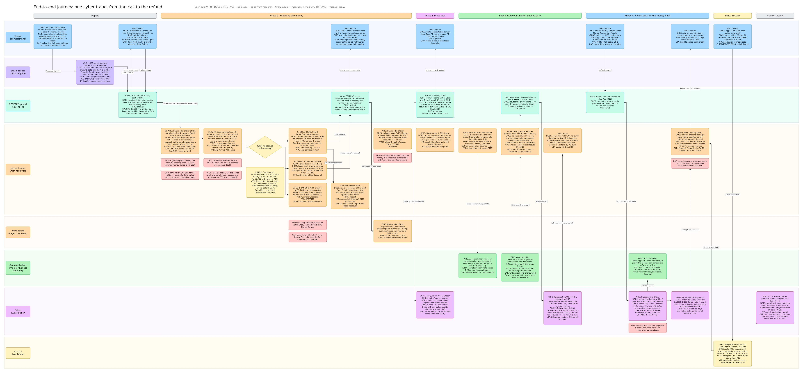
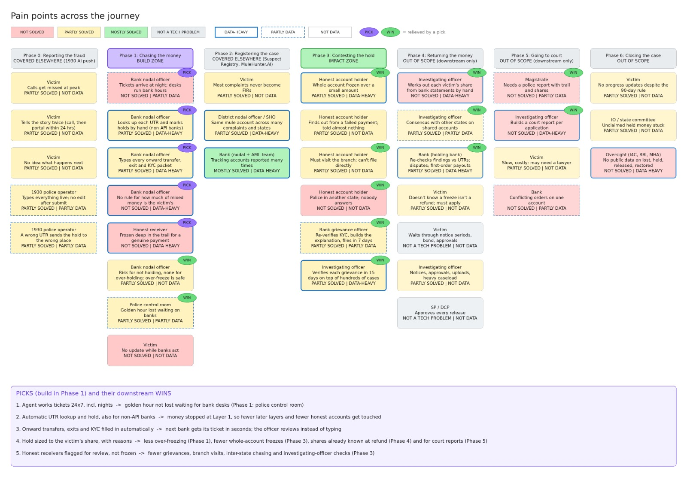

# Proportionate Holds: Problem Discovery

## Context

The build zone is the bank nodal officer inside the golden hour: holds that are fast and sized to the victim's money. This doc records how we got there, so the solution is built against evidence. What was built from it is in [DESIGN.md](DESIGN.md).

- **Event:** [ExaThon India 2026](https://www.exasol.com/events/exathon-india-2026/) by Exasol, Track 01: Money, Risk & Regulation.
- **Rules that shape scope:** 1 to 3 members; Exasol Personal must be the data platform; public repo under MIT or Apache 2.0; public or synthetic data only.
- **Starting point:** Shubham's concept doc "Proportionate Holds" (trace, attribute, score, recommend holds for cyber-fraud victims).

| Stage 1 criterion | Weight |
| --- | --- |
| Innovation and problem impact | 25% |
| Effective use of Exasol Personal | 25% |
| Technical excellence | 20% |
| Solution design and user experience | 15% |
| Documentation and reproducibility | 10% |
| Open-source quality | 5% |

In the final, the live demo is 40%, depth under Q&A 30%, real-world applicability 20% and communication 10%. Judges read the one-line problem statement first, in the form "\[Who\] can't \[do what\] because \[why\]. If this worked, \[what changes\].", with no technology named in it.

## How we worked

We mapped the real journey before discussing any solution, and judged every pain point by evidence, not by how well it fits a build.

1. **Journey first, solution later.** Walk one cyber-fraud case end to end, from the victim's call to the refund.
2. **Map every step to a named role.** An agent is easiest to explain when it does the work of a role that already exists (for example, "the 1930 police operator" or "the bank nodal officer").
3. **Find the formal medium at each handoff.** A portal is pointless if the official channel is email, so we checked how each message actually travels.
4. **Capture each step in one shape:** who (exact role), intent (what they are trying to do), time or SLA, and medium.
5. **Research in chunks, then park the rest.** Questions were agreed per phase before researching, so each finding answers a question we chose.
6. **Tag each pain point** by how solved it already is and how data-heavy it is, since Exasol only earns its place where the pain is a data problem.

Two framing rules came out of this: name phases in plain words (no codes), and mark anything unconfirmed as an open question rather than a fact.

## Stakeholders and roles

Nine parties touch one case; two of them (the bank nodal officer and the investigating officer) carry most of the manual work.

| Stakeholder | Exact role or designation | Phases | What they are trying to do |
| --- | --- | --- | --- |
| Victim | Complainant | All | Stop the money moving, then get it back |
| State police helpline | 1930 police operator (State/UT police; call-taker and ticket-raiser are the same person) | 0 | Record the fraud and raise a ticket on CFCFRMS during the call |
| National portal | CFCFRMS module of NCRP (I4C, MHA; built by NIC); Grievance Redressal Module and Money Restoration Module, live April 2026 | 0 to 4 | Route tickets, notices and requests between police, banks and victims |
| Receiving bank | Bank nodal officer (Layer-1 bank, first receiver) | 1, 2 | Find the payment, hold what is left, report onward transfers and exits |
| Next banks | Bank nodal officer at Layer 2 onward | 1 | Repeat the same steps until the money is held or exits |
| Bank grievance side | Branch-level and central or state-level bank grievance officers (separate from the nodal officer) | 3 | Verify the account holder and file grievances on the portal |
| Account holder | Mule, or honest receiver (merchant, salaried person) whose account is held | 3, 4 | Get legitimate money released |
| Police investigation | State and District Nodal Officers; SHO; Investigating Officer (IO); District Grievance Officer (Addl SP or DSP); State Grievance Officer (ADG, IG or DIG); SP or DCP for approvals | 2 to 6 | Register the case, decide grievances, work out shares, approve refunds |
| Courts | Magistrate; Lok Adalat with the Legal Services Authority | 5 | Order release when the police route stalls |

## Customer journey map

One case crosses eight lanes and about 30 steps; the money is decided in the first few columns, at the Layer-1 bank.

- **Lanes, top to bottom:** victim, state police 1930 helpline, CFCFRMS portal, Layer-1 bank, next banks, account holder, police investigation, court or Lok Adalat.
- **Each box** shows WHO (exact role), DOES (intent), TIME (SLA or what actually happens) and VIA (medium). **Arrow labels** carry the message and its medium.
- **Inside the Layer-1 bank, one ticket passes through three teams:** the portal desk reads it (5a), the core banking team looks it up and marks the hold (5b, 5c), the portal desk types onward transfers and exits back (5d), and the branch is told by screenshot (5e).
- **The diamond** branches the split case: money still there is held, money moved on creates a new ticket, money that left banking is recorded as an exit.
- **Red boxes** are gaps from research; "BY HAND" marks manual work today. Open the image full size to read it; the same content is in text in Phase-by-phase findings below.

## Phase-by-phase findings

The formal channel is a portal (CFCFRMS), not email: email and SMS are only alerts on top of portal tickets and electronic BNSS notices. Each phase below lists every step as who, intent, time or SLA, and medium, then the gaps found.

### Phase 0: Reporting the fraud

| # | Who | Intent | Time or SLA | Medium |
| --- | --- | --- | --- | --- |
| 1 | Victim | Report fast to stop the money moving | Golden hour; police advise the first hour | Phone call to 1930 (24x7 on paper) |
| 2 | 1930 police operator | Record name, mobile, bank, account or UPI ID, UTR, amount, date; check it is a cyber financial fraud; raise the ticket | During the call; no edit after submit; reporting within 48 hrs recommended | Phone, typed into CFCFRMS |
| 3 | CFCFRMS | Acknowledge the victim; route ticket and S.168 read with S.94 BNSS notice to the bank | Instant | SMS (header XXNCRP, 14-digit ack starting with 3); bank dashboard or API, plus email and SMS to the nodal officer |
| 4 | Victim | Re-file the full complaint with the ack number | Within 24 hours | cybercrime.gov.in |

- Calls get missed at peak; a national 1930 call centre with a zero-pendency rule was ordered in June 2026.
- The victim tells the same story twice (call, then portal).
- If the formal complaint is not filed, Delhi Police has said frozen funds may be released.

### Phase 1: Chasing the money

| # | Who | Intent | Time or SLA | Medium |
| --- | --- | --- | --- | --- |
| 5a | Bank nodal officer at the portal desk (card, cyber or fraud team at smaller banks) | Read the ticket and BNSS notice, check it is complete, pass it to the core banking team | SOP says "real-time" with no minutes set; desk often bank hours only; weekend response unpredictable | CFCFRMS dashboard or API; internal relay |
| 5b | Core banking team (IT department or central operations) | Find the UTR, check the balance, read the account statement for onward transfers and exits | No response time set | Core banking system (separate access from the portal) |
| 5c | Core banking team | Money still there: mark a lien up to the reported amount (whole-account freeze at bank or IO discretion). Empty first-layer account: hold marker for future credits, no SMS to victim | "Immediately", no SLA | Core banking system |
| 5d | Portal desk (nodal officer) | Money moved to another bank: enter each onward transfer under "Money transferred to" (unlisted bank via "Others"). Money left banking (ATM, cheque, AePS, POS, purchase, crypto): enter ATM ID, device ID, wallet, amount, location | Not set | CFCFRMS, typed by hand |
| 5e | Branch staff | Receive a screenshot of the alert from IT; tell the customer the account is held and advise them to approach the police | Not set | Screenshot (internal); SMS to customer |
| 7 | CFCFRMS | Create one new ticket per onward transfer, in parallel; tell the victim if money was held | Instant | Next bank's dashboard or API, email, SMS; SMS and email to victim with a release link |
| 8 | Next bank nodal officer (Layer 2 onward) | Repeat steps 5a to 5e until the money is held or exits | Same; no per-hop SLA | Same |
| 9 | Bank nodal officer | Upload the holder's KYC (name, address, PAN, customer ID, IFSC, mobile, email) and their other accounts, incl. abroad | Within 1 week of reporting | CFCFRMS |
| later | Department Head | Approve any release of the lien or freeze | Not set | Internal |

The person who sees the ticket is often not the person who can act on it: one cooperative bank's procedure has card and IT staff watch the portal, IT mark the lien, and branches learn by screenshot ([source](https://vvsb.bank.in/resources/assets/upload/file/96_20260713104332.pdf)). At large banks a central operations team reportedly marks liens ([practitioner account](https://vikramkushwaha.in/blog/lien-marked-bank-account-cyber-complaint/)). In August 2026, 14 banks had still not given their representatives at I4C's fraud centre core banking access, so they could not check accounts immediately ([source](https://the420.in/?p=94372)).

**Split case:** ₹2,00,000 lands in account A. ₹80,000 is still there and gets held; ₹50,000 was withdrawn at an ATM, so the ATM ID is recorded; ₹70,000 went to Bank Y, so an onward entry creates a new ticket for Bank Y. One officer, one ticket, three different actions.

- The bank cannot refuse an alert. The I4C FAQ recommends holding the amount but leaves a whole-account freeze to the bank or IO's discretion.
- No rule exists at hold time for how much of mixed money is the victim's; the pro rata rule applies only later, at refund.
- The notice warns of action under S.201 BNS for not complying, with no consequence for holding too much, so over-freezing is the rational choice.
- In Rajasthan, a night-time complaint missed the hold because bank representatives work banking hours; nationally about 29% of reported money was liened in H1 2026.
- Deep layers hit honest accounts: one Kochi firm was frozen at layers 9 and 10 over genuine payments.

### Phase 2: Registering the case

| # | Who | Intent | Time or SLA | Medium |
| --- | --- | --- | --- | --- |
| 10 | CFCFRMS | Forward the complaint to State and District Nodal Officers and the SHO; ask for an FIR where freezing or refund is planned | Automatic | Email and SMS from the portal |
| 11 | e-Zero FIR system | Auto-register an FIR above a state-set loss threshold (Delhi pilot ₹10 lakh; Goa ₹1 lakh), then transfer it to the territorial cyber station | Automatic; live in 18 states | NCRP linked with e-FIR and CCTNS |
| 12 | Victim | Convert the e-Zero FIR into a regular FIR | Within 3 days | In person at the station |
| 13 | Bank (nodal and AML team) | For accounts reported many times: enhanced due diligence; suspend digital banking or seize (seizure needs an FIR copy); share identifiers with the I4C Suspect Registry | On police direction | Portal |

- One FIR belongs to one complaint, not to an account; one account can sit under many complaints from different states.
- About 1.84 lakh FIRs came from over 82 lakh complaints (as of Feb 2026).
- The case is owned by the complainant's police station; the held account may be in another state.

### Phase 3: Contesting the hold

| # | Who | Intent | Time or SLA | Medium |
| --- | --- | --- | --- | --- |
| 14 | Bank branch and SMS system | Block debits on the held amount (or whole account); inform the holder | No notice deadline; the MP High Court now requires banks to inform and name the authority | Failed payment, SMS, branch |
| 15 | Account holder | Explain the money and get it released | Any time | In person at the branch (cannot file on the portal directly) |
| 16 | Bank grievance officer | Customer due diligence, KYC re-verification, enhanced checks; file the grievance | Within 7 days of the holder's complaint | Grievance Redressal Module |
| 17 | SHO, then Investigating Officer | Verify the holder (video call; CIAR on Samanvaya); lift the hold or record reasons | 15 days | Grievance module; SMS or email to the holder |
| 18 | District Grievance Officer, then State Grievance Officer (seizures) | Review the IO's decision | 15 days each; IO acts within 2 days; banks provide information within 2 days | Grievance module |
| 19 | Bank | Contested hold with no lawful direction by day 90: tell police 15 days before, then remove after checks on the holder's request | 90 days; police may extend by 90 | Portal; SMS to SHO |

- Holders usually learn from a failed transaction and are told only that a complaint came from state police.
- Written representations to nodal officers go unanswered for weeks; inter-state holds leave holders between two police systems.
- High Courts (Rajasthan, Allahabad, Delhi, MP, Telangana and others) keep ordering amount-only liens instead of whole-account freezes.

### Phase 4: Returning the money

| # | Who | Intent | Time or SLA | Medium |
| --- | --- | --- | --- | --- |
| 20 | Victim | Apply for the held money | Any time after a hold | Money Restoration Module: ack number and OTP, bank details, PAN copy; gets a tracking number (URN) |
| 21 | Investigating Officer | Notice the account holder and verify | Notice within 7 days; holder gets up to 15 days | Physical or electronic notice; video call |
| 22 | Investigating Officer | Single victim: below ₹50,000 no FIR needed, above needs one. Several victims: work out each share (attributed, else pro rata), record reasons; officers in other states must agree | Not set | Money Restoration Module |
| 23 | IO with SP or DCP approval | Order the bank to pay under S.106(3) BNSS; take the victim's indemnity bond; report to the magistrate | Order within 15 days | Notice to bank via portal; report to court |
| 24 | Bank (holding bank) | Check the findings, pay the victim, update the portal, inform all banks in the trail | Within 15 days of the order | Bank transfer; portal |

- Mumbai, two months: ₹18.27 crore blocked across 24,860 cases, ₹16.18 crore cleared for refund, ₹3.97 crore actually paid.
- Bengaluru, eight months: ₹513 crore frozen, ₹111 crore recovered; some banks pay whichever victim gets a court order first.

### Phase 5: Going to court

| # | Who | Intent | Time or SLA | Medium |
| --- | --- | --- | --- | --- |
| 25 | Victim | Get a release order when the police route stalls | Varies widely | Application under S.497, S.498 or S.503 BNSS, or Lok Adalat |
| 26 | Magistrate or Lok Adalat | Get the IO's report (trail, other complaints, shares) and order release | Lok Adalat clears cases in bulk on fixed dates | Police report; order served to the bank by the IO |
| 27 | Bank | Implement the order and update the portal | Not set | Portal |

- Telangana returned ₹45.21 crore to 6,303 victims in one Lok Adalat sitting (June 2026); Surat returned ₹2.52 crore to 61 victims in six months.

### Phase 6: Closing the case

| # | Who | Intent | Time or SLA | Medium |
| --- | --- | --- | --- | --- |
| 28 | IO or state committee | Dispose of unclaimed held money | Not set | Court application under S.503 or S.504 BNSS |
| 29 | Police | Update the victim on progress | Within 90 days (BNSS S.193) | Not specified |
| 30 | Oversight committee (RBI, DFS, IBA, IB, I4C) | Monitor the SOP and publish performance | Monthly report promised | Report; dashboards planned |

- Before the 2026 modules, only ₹167 crore (about 2.18%) of the ₹7,647 crore saved had been restored.

## Open questions

Six facts could not be confirmed from public sources; each should be stated as an assumption in the README or checked with someone who has worked a bank fraud desk.

- [ ] Is a hop to another account in the **same bank** a fresh ticket, or handled in the same pass? (Decides how big the same-bank speed win is.)
- [ ] Who can see the **full money trail**: police only, or every bank in it?
- [ ] When money splits to several banks, does the **same officer** type every onward entry? (Inferred from the I4C FAQ, not stated.)
- [ ] Do the email and SMS alerts to the bank nodal officer carry enough detail (UTR, amount, account) to act on without opening the portal?
- [ ] How many banks are on the **API** today versus working the dashboard by hand? (1,006 banks and FIs are onboarded; the API split is not public.)
- [ ] At large banks, are the **portal desk and core banking access** one person or two, and how long does each internal handoff take?

## Pain points

36 pain points across the journey; the 5 worth building for all sit in Phase 1, are data-heavy, and are not fully solved today.

Fill shows how solved a pain point is today (red not solved, yellow partly, green mostly, grey not a tech problem); a thick blue border means data-heavy, dashed means partly. Purple PICK tags mark the five Phase 1 pain points worth building for; green WIN tags mark the 13 they relieve downstream.

### Phases 0 to 2

| Phase | Stakeholder | Pain point | What exists today | Status | Data | Tag |
| --- | --- | --- | --- | --- | --- | --- |
| 0 | Victim | Calls get missed at peak | National 1930 call centre and IVR upgrades ordered June 2026; Goa AI call agent | Partly solved | Not data |  |
| 0 | Victim | Tells the story twice (call, then portal within 24 hrs) | Himachal links helpline to portal (15 to 20 min); banks may file on the customer's behalf | Partly solved | Not data |  |
| 0 | Victim | No idea what happens next | Ack SMS; portal status tracking | Partly solved | Not data |  |
| 0 | 1930 police operator | Types everything live; no edit after submit | Save-and-preview step only; MHA ordered AI for faster registration | Partly solved | Partly data |  |
| 0 | 1930 police operator | A wrong UTR sends the hold to the wrong place | Bank can send the ticket back for correction | Partly solved | Partly data |  |
| 1 | Bank nodal officer | Tickets arrive at night; desks run bank hours | Bank reps at I4C's fraud centre (some banks; core banking access gaps) | Not solved | Partly data | Pick |
| 1 | Bank nodal officer | Looks up each UTR and marks holds by hand | API since 2024, mainly larger banks | Partly solved | Data-heavy | Pick |
| 1 | Bank nodal officer | Types every onward transfer, exit and KYC packet | API for integrated banks only | Partly solved | Data-heavy | Pick |
| 1 | Bank nodal officer | No rule for how much of mixed money is the victim's | Nothing at hold time; pro rata applies only at refund | Not solved | Data-heavy | Pick |
| 1 | Honest receiver | Frozen deep in the trail for a genuine payment | Nodal, pool and escrow accounts flagged; MuleHunter.AI detects mules; nothing clears honest receivers | Not solved | Data-heavy | Pick |
| 1 | Bank nodal officer | Risk for not holding, none for over-holding | SOP amount-only default; High Court rulings; uneven compliance | Partly solved | Not data | Win |
| 1 | Police control room | Golden hour lost waiting on banks | Fraud centre; 1930 modernisation | Partly solved | Partly data | Win |
| 1 | Victim | No update while banks act | SMS only once money is held | Not solved | Not data |  |
| 2 | Victim | Most complaints never become FIRs | e-Zero FIR above a state threshold, 18 states | Partly solved | Not data |  |
| 2 | District nodal officer / SHO | Same mule account across many complaints and states | Suspect Registry; Samanvaya; Haryana building AI trail analysis | Partly solved | Data-heavy |  |
| 2 | Bank (nodal and AML) | Tracking accounts reported many times | Suspect Registry; MuleHunter.AI | Mostly solved | Data-heavy |  |

### Phases 3 to 6

| Phase | Stakeholder | Pain point | What exists today | Status | Data | Tag |
| --- | --- | --- | --- | --- | --- | --- |
| 3 | Honest account holder | Whole account frozen over a small amount | SOP default; High Court rulings | Partly solved | Data-heavy | Win |
| 3 | Honest account holder | Finds out from a failed payment; told almost nothing | MP High Court requires informing; 48-hour notice proposed | Partly solved | Not data |  |
| 3 | Honest account holder | Must visit the branch; cannot file directly | Grievance module via branch; proxies for seniors, disabled, terminally ill | Partly solved | Not data | Win |
| 3 | Honest account holder | Police in another state; nobody answers | Nothing; an inter-state desk has been proposed | Not solved | Not data | Win |
| 3 | Bank grievance officer | Re-verifies KYC, builds the explanation, files in 7 days | Grievance Redressal Module (April 2026) | Partly solved | Partly data | Win |
| 3 | Investigating officer | Verifies each grievance in 15 days on top of hundreds of cases | Video verification via Samanvaya; dedicated queue officers (Bhopal) | Partly solved | Data-heavy | Win |
| 4 | Victim | Doesn't know a freeze isn't a refund; must apply | Money Restoration Module; release link in the hold SMS | Partly solved | Not data |  |
| 4 | Victim | Waits through notice periods, bond, approvals | Fixed by law | Not a tech problem | Not data |  |
| 4 | Investigating officer | Works out each victim's share from bank statements by hand | SOP gives the principle; the module records the result; nothing calculates it | Not solved | Data-heavy | Win |
| 4 | Investigating officer | Consensus with other states on shared accounts | Module shows competing claims; agreeing is manual | Partly solved | Partly data | Win |
| 4 | Investigating officer | Notices, approvals, uploads on a heavy caseload | Video verification; dedicated queue officers | Partly solved | Not data |  |
| 4 | SP / DCP | Approves every release | Nothing found | Not a tech problem | Not data |  |
| 4 | Bank (holding bank) | Re-checks findings against UTRs; disputes; first-order payouts | SOP check-and-record rule | Partly solved | Data-heavy | Win |
| 5 | Victim | Slow and costly; may need a lawyer | Lok Adalats; several High Courts dropped the FIR requirement | Partly solved | Not data |  |
| 5 | Magistrate | Needs a police report with trail and shares | Restoration module and e-courts integration planned | Not solved | Partly data | Win |
| 5 | Investigating officer | Builds a court report per application | Nothing found | Not solved | Data-heavy | Win |
| 5 | Bank | Conflicting orders on one account | Nothing found | Not solved | Partly data |  |
| 6 | Victim | No progress updates despite the 90-day rule | Portal status tracking | Partly solved | Not data |  |
| 6 | IO / state committee | Unclaimed held money stuck | Court disposal; optional state committees | Partly solved | Not data |  |
| 6 | Oversight (I4C, RBI, MHA) | No public data on lost, held, released, restored | Monthly report promised, not found publicly | Not solved | Data-heavy |  |

Pick = worth building for. Win = relieved downstream if the picks are built.

## Direction

**Objective: hold as much of the victim's money as possible, as early in the trail as possible, sized to the victim's share.** Build in Phase 1, at the bank nodal officer; measure the win in Phase 3.

Speed matters beyond the victim: money held at the first account never reaches later ones, so every hop caught early is a set of downstream accounts (often honest ones) that never gets frozen. Speed alone is not enough, though: blanket freezing at the accounts you do reach comes from the over-freeze incentive, so holds must also be sized and explained.

| Phase | Zone | Why |
| --- | --- | --- |
| 0: Reporting the fraud | Covered elsewhere | MHA's 1930 AI modernisation and Goa's AI call agent already target it |
| 1: Chasing the money | **Build zone** | Not solved, data-heavy, inside the golden hour, one clear role to map an agent to |
| 2: Registering the case | Covered elsewhere | Suspect Registry and MuleHunter.AI handle repeat-account detection |
| 3: Contesting the hold | **Impact zone** | Every honest receiver not frozen in Phase 1 is a grievance never filed here |
| 4 to 6: Refund, court, closure | Out of scope | The trail is closed; delays are statutory windows, approvals and court dates that software cannot compress |

### The five picks

| # | Pick | Pain it answers | Downstream wins |
| --- | --- | --- | --- |
| 1 | Work tickets around the clock, including nights | Desks run bank hours | Golden hour not lost waiting for bank staff |
| 2 | Automatic UTR lookup and hold, also for banks not on the API | Manual lookup and holds | Money stopped at Layer 1, so fewer later layers and honest accounts are touched |
| 3 | Onward transfers, exits and KYC filled in automatically | Typing every entry by hand | Next bank gets its ticket in seconds; the officer reviews instead of typing |
| 4 | Hold sized to the victim's share, with written reasons | No rule for mixed money; over-freeze incentive | Fewer whole-account freezes (Phase 3); shares already known at refund (Phase 4) and for court reports (Phase 5) |
| 5 | Honest receivers flagged for review, not frozen | Deep-layer freezes of genuine payments | Fewer grievances, branch visits, inter-state chasing and officer checks (Phase 3) |

Picks 1 to 3 are the speed half; picks 4 and 5 are the precision half. Together they are the pitch.

### Role and positioning

- **The agent does the bank nodal officer's ticket work; the officer stays the reviewer and approver.** The officer cannot refuse an alert but does decide how much to hold, which is exactly the judgment courts scrutinise, so the review must be meaningful.
- **API integration already automates lien marking for larger banks.** The gap left is banks not on the API, after-hours tickets, and the quality of holds (sized, explained, honest receivers spared).
- **Downstream claim, no extra build:** because every hold records whose money it is and how much, the refund stage starts with the shares already known.

### Draft problem statement (to refine)

> A bank nodal officer can't act on every cyber-fraud ticket within the golden hour, because tracing, holding and reporting each hop is manual and stops outside banking hours. If this worked, more of each victim's money would be held at the first account, and honest receivers further down the trail would not be frozen.

## The product

**A golden-hour copilot for the bank nodal officer: it works every cyber-fraud ticket the moment it lands, follows the victim's money through the bank, and proposes holds sized to the victim's share, with reasons, for the officer to approve.**

Today a person reads each ticket, looks up the payment, decides how much to freeze and types everything back into the portal, mostly in banking hours. The product does that work instantly and around the clock, so money is stopped at the first account instead of several hops later; the officer reviews instead of typing.

### What it does, in the order a ticket flows

1. **Picks up the ticket instantly, at any hour.** No waiting for the desk to open.
2. **Traces the money forward** through the bank's own accounts, every hop at once rather than one ticket at a time.
3. **Works out how much of the victim's money is in each account**, even when it is mixed with the holder's own money.
4. **Proposes an action per account, with written reasons:**
   - hold the victim's share (amount only),
   - full freeze, only where the account's history justifies it,
   - flag a likely honest receiver for review instead of freezing,
   - record an exit (ATM, crypto, purchase),
   - prepare the onward entry for the next bank.
5. **The officer approves, edits or rejects.** Nothing is held without a human decision.
6. **Fills in the paperwork:** onward transfers, exits and the KYC packet, ready for the portal.
7. **Records whose money each hold is and how much**, so the refund stage starts with the shares already known.

### Where Exasol does the work

Steps 2, 3 and the evidence behind step 4: tracing payments across millions of transactions, replaying balances to see what is left of the victim's money, and reading an account's history, all as set-based work inside the database.

### How we will know it works

| Measure | Compared on the same case |
| --- | --- |
| Victim's money held within the golden hour | Today's process vs the product |
| Honest money locked along the way | Today's process vs the product |
| Time from ticket to hold | Today's process vs the product |

A real bank sees only its own accounts, so hops to other banks still travel through the portal; the demo simulates that boundary and says so.

### What we are not building, and why

**Not a mule detector.** Three reasons:

- **It is after the fact.** Detection does not stop mule accounts being opened; that is an onboarding and KYC problem upstream of this journey.
- **It is already covered.** RBI Innovation Hub's MuleHunter.AI and the I4C Suspect Registry do this nationally.
- **The biggest protection for honest accounts needs no classification.** Money stopped at the first account never reaches the honest accounts further down the trail.

**But the account signal stays, as an input, not the product.** The bank cannot refuse an alert, but it does decide how much to hold: the [I4C FAQ](https://azhimukham.com/wp-content/uploads/2023/04/citizen-financial-fraud-reporting-management-system-FAQ.pdf) leaves a whole-account freeze to the bank or investigating officer's discretion. The [Rajasthan High Court](https://www.moneylife.in/article/no-blanket-freezing-of-bank-accounts-in-cybercrime-cases-rajasthan-hc-sets-rules/81455.html) allows a full freeze only in exceptional cases, such as a deliberately operated mule account or repeated suspicious credits followed by onward transfers. So the question the product answers is not "is this a mule?" but **"how much should we hold here, and can we defend it?"**

Also not: a replacement for CFCFRMS (it works the tickets CFCFRMS sends), a refund or court tool, or an autonomous system.

## Combined design

**Shubham's engine, our framing, a smaller shell: a bank-side agent that works every cyber-fraud ticket the moment it lands, traces the money, holds what the rules require automatically, and hands the officer a ready proposal for every judgment call, sized to the victim's share with reasons.**

### Automatic vs officer

The agent does what the rules already require, instantly; the officer decides what the rules leave to judgment. The agent never places a full freeze on its own.

| The agent does automatically, any hour | The officer decides |
| --- | --- |
| Hold up to the reported amount on the account that received it (mandatory; the bank cannot refuse) | **Narrow:** hold less on a likely honest receiver, sized to the victim's actual share |
| Record exits (ATM, crypto, purchase) with identifiers | **Widen:** full freeze where the account's history justifies it, with reasons written down |
| Prepare onward entries for other banks | Anything the agent is unsure about |
| Draft the KYC packet |  |

### Component by component

| Component | From Shubham's doc | What changes | Serves pick |
| --- | --- | --- | --- |
| Ticket intake | Not there | New, small: a simulated CFCFRMS queue the agent picks up instantly, timestamped | 1 |
| Trace | Keep: recursive SQL from the UTR, loop-safe, other banks become referrals, exits recorded | All same-bank hops in one pass; output becomes onward entries | 2, 3 |
| Attribute | Keep, as the core: LIBR replay in a Python UDF, conserved to the paisa, oracle tests | Drop the three-rule comparison for officers; LIBR by default, pro rata only for many victims in one account | 4 |
| Account evidence | Keep the nine signals | Lead with the action and its reasons (amount only, propose narrow, propose full freeze), not a MULE or HONEST label | 4, 5 |
| Recommend | Keep the rule table | Lane A (police-instructed) only; every rule marked automatic or officer | 2, 4, 5 |
| Paperwork | Partly (evidence report) | New: onward transfer entries, exit records and KYC packet, ready to push | 3 |
| Officer console | Keep, trimmed: inbox, trail graph, account panel, approve, edit or reject | Inbox splits "done automatically overnight" from "waiting for you" | All |
| Audit | Keep: every number links to the Exasol statement behind it | None | 4 |
| Compare screen | Keep: today vs product on the same case | Today's baseline includes the desk being closed overnight | Demo |
| Scale run | Keep as a stretch: thousands of tickets over the AMLworld dataset | Framed as "a full day of tickets, worked at once" | Exasol score |

### What gets cut

| Cut | Why |
| --- | --- |
| Lane B (RBI draft, bank-initiated holds) | Draft rules, separate legal flow, outside the golden-hour story |
| Notices in English, Hindi and Tamil | Real pain, but not data-heavy and a project of its own |
| Deadline countdowns (7, 15, 90 days) | Phase 3 machinery, outside the build zone |
| Victim status and receiver notice views | Nice to have, not core |
| Investigator plain-English Q&A | No pain behind it in the journey; optional twist if time allows: officer asks "why was this held?" through Exasol's MCP server |
| FIFO comparison on screen | Adds explanation, not decisions |

### Where AI fits

Tracing, attribution and the rules stay deterministic, which is what makes each hold defensible. An LLM earns a small place writing the officer-facing reasons in plain words and summarising cases for the morning review: "AI reads and writes; rules and the officer decide."

### Agentic version

If the build must be agentic: **the agent orchestrates, the database calculates, the rules permit, the officer decides.** The LLM chooses what to look at and what to do next; it never computes an amount or places a judgment-call hold.

**Maker, checker, approver.** Banks already run on maker-checker, so the agent maps onto existing practice:

- **Maker (the agent):** works the ticket end to end through tools and drafts a case file.
- **Checker (deterministic):** every proposal must pass a policy and conservation check; amounts reconcile to the paisa and the action must be on the allowed list.
- **Approver (the officer):** signs off anything discretionary.

A second LLM as checker is possible but weaker: a deterministic checker is the better answer to "what if the model is wrong?"

| Tool | What it does | Runs where | Can change anything? |
| --- | --- | --- | --- |
| read\_ticket | Parse the ticket and notice; flag a missing amount, UTR or legal basis | LLM plus validation | No |
| trace\_money | Follow the payment forward through the bank's accounts | Exasol, recursive SQL | No |
| attribute\_victim\_share | Work out the victim's rupees per account (LIBR) | Exasol, Python UDF | No |
| get\_account\_evidence | The nine signals and recent history for one account | Exasol, SQL | No |
| allowed\_actions | Return what is permitted for these facts: automatic, needs officer, or forbidden | Rules engine | No |
| place\_mandatory\_hold | Hold up to the reported amount on the receiving account | Simulated core banking | Yes, the only action it can take |
| record\_exit, draft\_onward\_entry, draft\_kyc\_packet | Prepare the portal paperwork | Exasol plus templates | Drafts only |
| escalate\_to\_officer | Queue a proposal with reasons for the officer | Console | No |
| write\_case\_summary | Plain-language summary of what was done and why | LLM | No |

Reads go through Exasol's read-only, row-limited MCP server. There is deliberately no full-freeze tool; the agent can only propose one.

**Where the agent earns its place over a script:**

1. **Messy inputs:** an old-format notice with no disputed amount, or a wrong UTR, gets a drafted "send back for correction" note instead of a freeze on bad data.
2. **Deciding how deep to look:** a clean mule pattern is held and closed; a merchant-like account triggers more evidence, a share calculation and a narrow proposal.
3. **Exceptions:** an unlisted bank ("Others"), nodal or pool accounts (amount only), empty first-layer accounts (hold marker), money split across several banks at once.
4. **Writing for people:** reasons the officer can sign, the morning briefing, the customer message.

**The 2:13 a.m. run, as the demo log shows it** (each line a tool call with its Exasol statement ID):

1. Ticket arrives; the notice is complete.
2. Trace: four hops inside the bank, one to Bank Y, one ATM exit.
3. Attribute: the victim's share per account.
4. Accounts A and C: mule-like pattern; automatic hold allowed. Held.
5. ATM exit: identifiers recorded.
6. Bank Y: onward entry drafted.
7. Murugan: merchant pattern, victim share ₹500 of a ₹1,000 credit. Mandatory ₹1,000 held automatically; the proposal to narrow is escalated.
8. Checker: all amounts reconcile; case summary written.

At 9 a.m. the officer sees what was done overnight and one decision waiting.

**Guardrails to state in the pitch:**

- The LLM never does arithmetic on money; every number comes from a database query.
- Allowed actions come from the rules engine, not the model.
- Every tool call and its statement ID goes to an append-only log.
- If the model fails or is switched off, a fixed pipeline runs the same tools in a fixed order; the demo shows both, and the agent's edge is the messy cases.

**Trade-off:** agentic adds risk to a short build (non-deterministic demos, prompt debugging, scrutiny of an LLM near a freeze). Keeping the LLM on orchestration and writing contains it, and the fixed pipeline is the fallback.

### Demo story

Shubham's case with one change: the fraud happens at 2:13 a.m.

- **Today:** the ticket waits until the desk opens at 10 a.m. Account C cashes out at 4:30 a.m. Murugan's whole ₹8.19 lakh account is frozen in the morning over a ₹1,000 diesel sale.
- **With the product:** at 2:13 a.m. the agent traces every hop in seconds, auto-holds the required amounts on A and C, records the ATM exit, prepares the onward entry for Bank Y, and holds only ₹1,000 on Murugan with a proposal to narrow it to his ₹500 LIBR share. At 9 a.m. the officer sees what was done overnight and two decisions waiting, and approves both.
- **Scoreboard:** victim's money held, honest money locked, time from ticket to hold, before vs after, live.
- **Data fix:** place Murugan's account at the same bank (an open point in Shubham's doc).

## What changed from the concept doc

The concept doc named attribution as the core gap but proved its impact with speed and with not freezing whole accounts; the research keeps attribution, but as the precision half of a golden-hour tool.

| Concept doc said | What we found | Change |
| --- | --- | --- |
| The gap is attribution, not tracing | Headline wins (victim money held 35% to 75%; ₹8.19 lakh to ₹0 locked) came from holding account C in time and from an amount-only hold, not from attribution | Lead with speed at Layer 1; attribution becomes hold sizing |
| Hop-by-hop delay of about 2 hours inside the bank | Baseline was simulated; same-bank hop handling is not documented | Keep as an open question; state the assumption |
| Mule-or-honest scoring as a core step | RBI Innovation Hub's MuleHunter.AI and the I4C Suspect Registry already cover mule detection | Position as "spare honest receivers with reasons", not mule detection |
| Investigator asks questions in plain English | No evidence of this pain in the journey | Drop or tie to a real pain later |
| Lane B (RBI draft rules for bank-initiated holds) | Not researched in this pass | Park until scope is set |
| Notices, deadlines, victim status views | Real pains, but mostly not data-heavy | Secondary; only if time allows |

The agent idea came from mapping roles: the bank nodal officer's work is a fixed script (find, hold, report onward, report exits, upload KYC) that cannot refuse an alert, which makes it the cleanest role for an agent to take over with a human reviewer.

## Sources

- [ExaThon India 2026: rules, timeline, judging](https://www.exasol.com/events/exathon-india-2026/)
- [MHA SOP for NCRP-CFCFRMS, custody, restoration and grievance redressal, 2 Jan 2026](https://the420.in/wp-content/uploads/2026/01/sop.pdf)
- [I4C CFCFRMS FAQ for banks and police](https://azhimukham.com/wp-content/uploads/2023/04/citizen-financial-fraud-reporting-management-system-FAQ.pdf)
- [I4C: CFCFRMS, Cyber Fraud Mitigation Centre, API integration](https://website-pmsma-app-dev.demo-01.perfectergonomicssystems.in/i4c-website/node/781)
- [Vikaspedia: CFCFRMS workflow](https://en.vikaspedia.in/viewcontent/e-governance/citizen-services/citizen-financial-cyber-fraud-reporting-and-management-system?lgn=en)
- [Vasai Vikas Sahakari Bank: CFCFRMS SOP](https://vvsb.bank.in/resources/assets/upload/file/96_20260713104332.pdf)
- [Canara Bank: checklist before calling 1930](<https://canarabank.com/UploadedFiles/Pdf/(57)%20Special%20Advisory%20Cyber%20Jagrookta%20Divas-April%202023.pdf>)
- [Communications Today: Delhi Police on the 24-hour rule](https://www.communicationstoday.co.in/?p=140566)
- [The Tribune: Himachal 1930 linked to the portal](https://www.tribuneindia.com/news/himachal/cybercrime-helpline-number-linked-with-national-portal)
- [ThreatCluster: national 1930 call centre, June 2026](https://threatcluster.io/cluster/amit-shah-calls-for-national-call-centre-to-strengthen-cyber-2451dd0d)
- [EaseMyPrep: 1930 AI modernisation directive](https://easemyprep.in/news/2219-amit-shah-reviews-national-cyber-crime-helpline-1930-orders-ai-based-modernizati)
- [Telangana Today: Goa's AI call agent for 1930](https://telanganatoday.com/goa-police-should-become-no-1-in-tackling-narcotics-amit-shah)
- [The Week: gaps in banking and policing](https://www.theweek.in/theweek/current/2026/08/14/how-gaps-in-banking-and-policing-are-fuelling-cyber-fraud.html)
- [The420: holds missed after banking hours (Rajasthan)](https://the420.in/?p=94888)
- [The420: fraud centre bank access gaps](https://the420.in/?p=94372)
- [Anantam IAS: H1 2026 lien rate](https://anantamias.com/?p=36896)
- [LiveLaw: Problem with CFCFRMS](https://www.livelaw.in/articles/cfcfrms-reading-mha-new-account-freeze-sop-537503)
- [LiveLaw: Allahabad High Court on lien vs freeze](https://www.livelaw.in/high-court/allahabad-high-court/cyber-fraud-allahabad-hc-bank-lien-disputed-amount-mha-sop-545790)
- [LiveLaw: MP High Court guidelines](https://www.livelaw.in/amp/high-court/madhya-pradesh-high-court/freezing-bank-accounts-guidelines-cybercrime-complaints-grievance-redressal-543201)
- [Moneylife: Rajasthan High Court rules](https://www.moneylife.in/article/no-blanket-freezing-of-bank-accounts-in-cybercrime-cases-rajasthan-hc-sets-rules/81455.html)
- [Delhi High Court: Tanmay Maini](https://delhihighcourt.nic.in/app/showFileJudgment/60917042026CRLW12302026_162029.pdf)
- [Gauhati High Court: Inamul Hoque](https://courtkutchehry.com/judgments/inamul-hoque-vs-union-of-india-and-ors)
- [The420: I4C Suspect Registry](https://the420.in/?p=90888)
- [The Hitavada: I4C and RBIH MoU on MuleHunter.AI](https://www.thehitavada.com/Encyc/2026/5/13/mou-signed-to-curb-mule-accounts-shah.html)
- [Vision IAS: complaints vs FIRs](https://visionias.in/current-affairs/upsc-daily-news-summary/article/2026-02-12/the-indian-express/security/100-victims-every-hour-amit-shah-warns-of-national-crisis-says-cybercrime-has-become-an-industry)
- [Outlook Money: e-Zero FIR launch](https://www.outlookmoney.com/news/govt-launches-e-zero-to-auto-convert-cybercrime-complaints-into-firs-speed-up-investigations)
- [Deccan Chronicle: e-Zero FIR in 18 states](https://www.deccanchronicle.com/amp/nation/cyber-fraud-cases-delhi-records-highest-number-of-e-zero-firs-among-18-states-uts-1974630)
- [The Goan: Goa lien rate and e-Zero FIR threshold](https://www.thegoan.net/goa-news/goa-sets-national-benchmark-in-cyber-fraud-crackdown/144483.html)
- [The420: one account in 194 complaints](https://the420.in/etah-cyber-fraud-sbi-account-194-complaints/)
- [The420: Money Restoration Module](https://the420.in/cyber-fraud-money-restoration-module-frozen-funds-online-refund-request/)
- [IMPRI: grievance and restoration modules live April 2026](https://www.impriindia.com/insights/policy-update/citizen-financial-cyber-fraud-reporting-and-management-system-cfcfrms-strengthening-indias-response-to-digital-financial-fraud/)
- [The Free Press Journal: Mumbai restoration figures](https://www.freepressjournal.in/mumbai/mumbai-police-help-6096-cyber-fraud-victims-recover-397-crore-through-money-restoration-module)
- [The Free Press Journal: Bhopal portal officers](https://www.freepressjournal.in/bhopal/bhopal-police-appoint-four-cyber-cell-sis-to-speed-up-fraud-refunds-lift-bank-holds)
- [Deccan Herald: Bengaluru frozen vs recovered](https://www.deccanherald.com/india/karnataka/bengaluru/cybercrimes-catch-22frozen-accounts-and-recovery-woes-3280456)
- [Siasat: Telangana Lok Adalat refunds](https://www.siasat.com/telangana-rs-45-cr-returned-to-cyber-fraud-victims-in-lok-adalat-3493462/)
- [NewKerala: Surat refunds](https://www.newkerala.com/news/a/gujarat-surat-cyber-crime-cell-returns-rs-252-552.htm)
- [The CSR Journal: Patna cyber police caseload](https://thecsrjournal.in/over-300-cases-registered-daily-patna-cyber-crime-branch-bihar-police/)
- [UNI: Haryana AI trail analysis](https://test.uniindia.com/news/north/admin-hyn-ai-police-cybercrime/3960495.html)

* [Vikram Kushwaha: how banks handle cyber liens (practitioner account)](https://vikramkushwaha.in/blog/lien-marked-bank-account-cyber-complaint/)